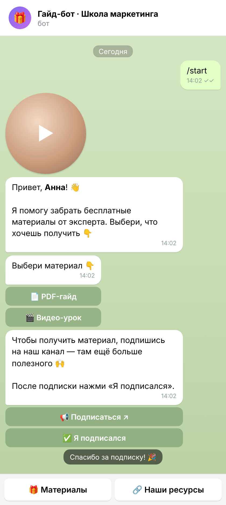
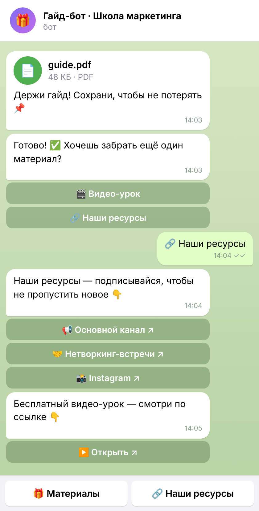
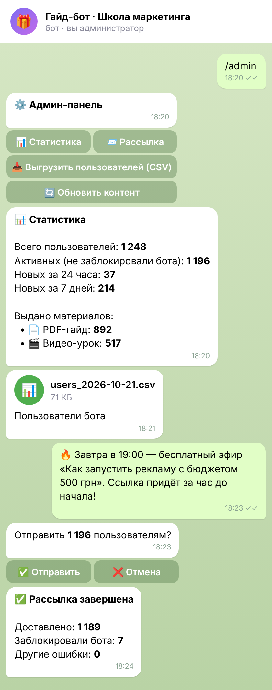

# Lead Magnet Bot — Telegram-бот для выдачи бесплатных материалов

Бот помогает эксперту или онлайн-школе собирать подписчиков: пользователь выбирает бесплатный материал (PDF-гайд, видео, ссылку), бот проверяет подписку на канал и только после этого выдаёт материал. Владелец видит статистику, делает рассылки и выгружает базу пользователей прямо из Telegram.

## Скриншоты

_Данные на скриншотах демонстрационные._

| Старт и проверка подписки | Выдача материалов | Админ-панель |
|---|---|---|
|  |  |  |

## Возможности

**Для пользователя**
- Приветствие по имени и видеокружок при старте
- Меню бесплатных материалов: файлы (PDF, видео, фото) и ссылки
- Проверка подписки на канал перед выдачей, кнопки «Подписаться» и «Я подписался»
- После выдачи бот предлагает забрать другие материалы и подписаться на ресурсы (канал, Instagram и т.д.)
- Постоянное меню внизу экрана для повторного доступа

**Для владельца (команда `/admin`)**
- 📊 Статистика: всего пользователей, новые за сутки и неделю, сколько раз выдан каждый материал
- 📨 Рассылка любого сообщения (текст, фото, видео, файл) с предпросмотром и подтверждением; учитывает лимиты Telegram и отмечает тех, кто заблокировал бота
- 📥 Выгрузка пользователей в CSV (открывается в Excel)
- 🔄 Обновление текстов и материалов без перезапуска: тексты, кнопки и ссылки хранятся в `content.json`; если в файле ошибка, бот сообщит, где она, и продолжит работать со старой версией

## Технологии

Python 3.11+ · aiogram 3 · SQLite · Docker

## Структура

```
lead_bot/
├── main.py            # запуск бота
├── config.py          # настройки из .env
├── content.py         # загрузка и проверка content.json
├── content.json       # тексты, материалы, ссылки (правит владелец)
├── db.py              # база SQLite: пользователи и выдачи
├── keyboards.py       # клавиатуры
├── handlers/
│   ├── user.py        # сценарий пользователя
│   └── admin.py       # админ-панель и рассылка
├── media/             # файлы материалов
├── Dockerfile
└── docker-compose.yml
```

## Запуск

1. Создайте бота у [@BotFather](https://t.me/BotFather) и получите токен.
2. Добавьте бота **администратором** в канал, подписку на который нужно проверять (без этого Telegram не даёт проверить подписку).
3. Скопируйте `.env.example` в `.env` и заполните `BOT_TOKEN`, `ADMIN_IDS`, `CHANNEL_ID`.
4. Положите свои файлы в папку `media/` и пропишите их в `content.json`.

**Локально**
```bash
python -m venv venv
venv\Scripts\activate          # Windows  (Linux/macOS: source venv/bin/activate)
pip install -r requirements.txt
python main.py
```

**На сервере через Docker**
```bash
docker compose up -d --build
docker compose logs -f         # посмотреть логи
```

## Как менять контент

Откройте `content.json`:

- `texts` — все тексты бота. В приветствии `{name}` заменяется на имя пользователя. Можно использовать HTML: `<b>жирный</b>`, `<i>курсив</i>`.
- `materials` — список материалов. Тип `document`, `video` или `photo` берёт файл из `file`, тип `link` отправляет кнопку со ссылкой из `url`.
- `links` — кнопки «Наши ресурсы».
- `welcome_video_note` — видеокружок при старте (квадратное mp4 до 60 секунд). Оставьте пустым, чтобы не отправлять.

После сохранения нажмите в админ-панели «🔄 Обновить контент».
